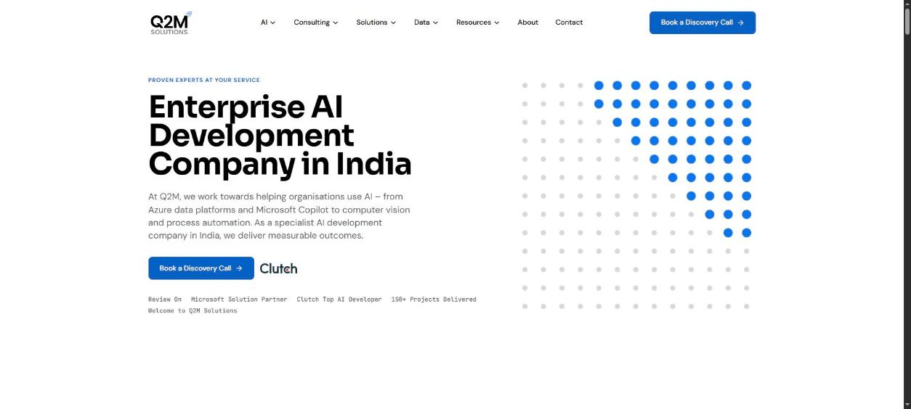
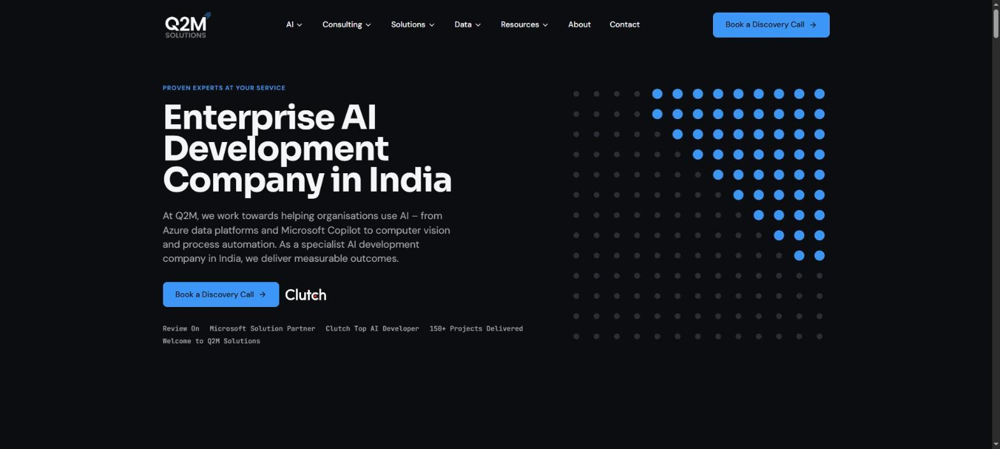

# Q2M Solutions website

A premium React rebuild of [q2msolutions.com](https://q2msolutions.com/), localised for India. It runs on the live site's content (synced at build time), uses the Q2M brand kit, and supports light and dark themes.



| Dark theme | Service page |
|---|---|
|  |  |

## What it is

- **61 routes:** home, about, contact, the service pages, blog listing and articles, case-study listing and 3 case studies, and an India privacy policy page (draft, marked for legal review).
- **Live content, exact:** page text, images and menus are synced from the live site, then adjusted by logged rules only (British spelling, India overrides, typo fixes). Every difference is listed in `docs/CONTENT_VERIFICATION.md`.
- **Live images:** the same images as the live site, served locally and optimised to AVIF/WebP. Placeholder and theme-demo images are never shown.
- **Brand kit:** Sora, DM Sans and JetBrains Mono, the Q2M colours, flat borders instead of shadows.
- **Consistency by design:** one shared layout (sticky left column), one hero component, one image component, one navigation source, so every page behaves the same.
- **India:** INR, IST, +91, DPDP consent, GSTIN/PIN/state form fields, `en-IN` SEO.

## Tech stack

Vite 8, React 19, TypeScript, Tailwind CSS 4, React Router 7, Motion, React Hook Form with Zod, Lucide icons.

## Getting started

```bash
npm install
npm run dev        # http://127.0.0.1:5173
npm run build      # typecheck + production build into dist/
npm run preview    # serve the production build
```

## Content and image pipeline

| Command | What it does |
|---|---|
| `npm run sync` | Full refresh: live content, apply rules, verify, flags, images, optimise, SEO files |
| `npm run content` | Fetch the raw live pages |
| `npm run content:compare` | Compare live and local content |
| `npm run images` | Sync live images and build the AVIF/WebP variants |
| `npm run seo` | Regenerate sitemap and SEO files |
| `npm run brand:assets` | Regenerate the default Open Graph image (1200×630) and favicon set |

## Project layout

```
src/
  components/   shared UI (Layout, ui.tsx: Button, SiteImage, HeroImage, Seo ...)
  pages/        page templates (ServicePage, Stories, Company, Home ...)
  content/      live content (exact) and final content (after rules)
  config/       India locale, booking, company details, image rules
  lib/          helpers (images, nav, seo, format)
  styles/       Tailwind theme tokens and shared layout classes
public/         images (originals and optimised), brand assets, icons
scripts/        content and image pipeline
docs/           reports and decisions (see below)
```

## Reports and decisions (`docs/`)

| File | Contents |
|---|---|
| `CONTENT_VERIFICATION.md`, `CONTENT_CHANGES.md`, `CONTENT_FLAGS.md` | What changed from live content, and what needs a decision |
| `IMAGE_COMPLETENESS.md`, `IMAGE_SYNC_REPORT.md` | Live vs local images, per page |
| `HOME_IMAGE_MAPPING.md` | Proposed home page images, awaiting approval |
| `LOWRES_HEROES.md` | The 466×291 heroes and how they are shown (never enlarged) |
| `PLACEHOLDER_SECTIONS.md` | Sections where the live site shows a page-builder placeholder |
| `RESPONSIVE_TEST.md` | 61 routes × 360/768/1024px × light/dark |
| `INDIA_LOCALISATION.md` | India settings and open legal items |

`docs/_prev/` and `src/pages/HomeFolder.tsx` are backups of earlier work. Do not delete them without asking.

## Open items

Everything still waiting on a decision or on information from Q2M is listed in [docs/OPEN_DECISIONS.md](docs/OPEN_DECISIONS.md).

## Git workflow

See [CLAUDE.md](CLAUDE.md): everyday work on `dev`, releases to `main` only on request (tag `release-YYYY-MM-DD`), never force-push.

## Quality checks

Browser and production checks live in [scripts/qa/](scripts/qa/README.md) (separate dependencies; `cd scripts/qa && npm install`).

## Deployment

The production build is published to the `build` branch (its root is exactly the web root). Hosting steps for the admin: [docs/DEPLOYMENT_FOR_ADMIN.md](docs/DEPLOYMENT_FOR_ADMIN.md). Redirect files for old URLs: `docs/deploy/` (generated by `scripts/redirects.mjs`, also copied into every build).
